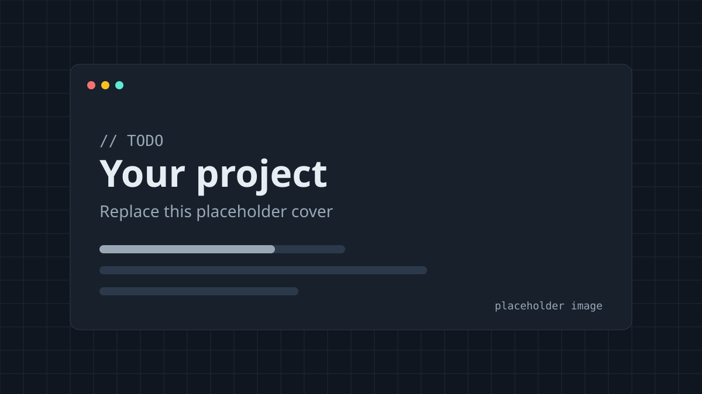

# Portfolio — web developer & security engineer

Personal portfolio built to show two things at once: polished front-end work, and a site
hardened like a production app. The [`/security`](src/app/security/page.tsx) page explains every
header and trade-off, and renders the live values straight from the code.


<!-- TODO: replace with a real screenshot of the home page -->

## Highlights

- **Strict CSP with per-request nonces.** `script-src 'nonce-…' 'strict-dynamic'`, no `unsafe-inline`
  or `unsafe-eval` for scripts. See [src/proxy.ts](src/proxy.ts) and
  [src/lib/security-headers.ts](src/lib/security-headers.ts).
- **Full security header set.** HSTS (preload), nosniff, Referrer-Policy, Permissions-Policy, X-Frame-Options,
  COOP, CORP, and no `X-Powered-By`.
- **RFC 9116 `security.txt`** generated from config at `/.well-known/security.txt`.
- **Zero third-party requests.** Fonts are self-hosted at build time. No analytics, embeds or CDNs.
- **No inline theme script.** Dark/light choice lives in a cookie and is rendered server-side, so the
  correct theme is in the first paint without a script.
- **Hardened contact form.** Server Action (Origin-checked), honeypot, rate limiting (Upstash
  over REST, IPs hashed), zod validation, plain-text email via Resend. Falls back to `mailto:` when
  not configured.
- **MDX content** for case studies and posts, validated with zod at build time. Syntax highlighting
  runs at build time (Shiki) and ships no client-side JavaScript.
- **SEO.** Per-page metadata and canonical URLs, generated Open Graph images per project/post,
  `sitemap.xml`, `robots.txt`, JSON-LD (`Person`, `BlogPosting`).
- **Accessibility.** Semantic landmarks, skip link, visible focus styles, WCAG AA colour tokens,
  `prefers-reduced-motion` respected, works without JavaScript (filters and form included).

## Tech stack

| Area      | Choice                                          | Why                                                               |
| --------- | ----------------------------------------------- | ----------------------------------------------------------------- |
| Framework | Next.js 16 (App Router), React 19               | Server Components, built-in nonce support, `next/og`, `next/font` |
| Language  | TypeScript (strict, `noUncheckedIndexedAccess`) |                                                                   |
| Styling   | Tailwind CSS v4                                 | Design tokens as CSS variables, no UI kit                         |
| Content   | MDX via `@next/mdx`                             | Official integration; content lives in `/content`, no CMS or DB   |
| Hosting   | Vercel                                          |                                                                   |

### Dependencies (and why each exists)

Runtime (10): `next`, `react`, `react-dom` · `@next/mdx`, `@mdx-js/loader`, `@mdx-js/react` (MDX
compilation) · `remark-gfm` (tables, task lists) · `rehype-pretty-code` + `shiki` (build-time
syntax highlighting) · `zod` (content and form validation).

Dev: TypeScript and types, Tailwind and its PostCSS plugin, ESLint with `eslint-config-next`,
Prettier with the Tailwind class-sorting plugin.

Deliberately **not** used: UI kits, icon libraries (inline SVG instead), `next-themes` (a cookie
does it with no inline script), gray-matter (typed `export const meta` instead), reading-time
packages (a 40-line remark plugin, [src/lib/mdx/remark-reading-time.mjs](src/lib/mdx/remark-reading-time.mjs)),
and the Resend/Upstash SDKs (one `fetch` each).

### Deviation from "SSG for every page"

A per-request nonce means HTML can't be pre-rendered at build time, so **pages render per
request**. Everything else (OG images, sitemap, robots, security.txt, MDX compilation) is still
static. This is the documented trade-off for a CSP without `unsafe-inline`; see `/security`.

## Local setup

Requires Node 20.9+ (Node 24 recommended, see `.nvmrc`).

```bash
npm install
```

```bash
cp .env.example .env.local
```

```bash
npm run dev
```

Open http://localhost:3000. Useful scripts:

| Script                               | Does                                                                          |
| ------------------------------------ | ----------------------------------------------------------------------------- |
| `npm run check`                      | lint + type-check + production build                                          |
| `npm run lint` / `npm run typecheck` | ESLint / `tsc --noEmit`                                                       |
| `npm run format`                     | Prettier (write)                                                              |
| `npm run build && npm start`         | Production build locally (use this to test the real CSP; dev mode relaxes it) |

## Editing content

**Personal details:** everything lives in [src/config/site.ts](src/config/site.ts); skills are in
[src/config/skills.ts](src/config/skills.ts).

### Add a project

1. Copy `content/projects/_template.mdx` to `content/projects/<slug>.mdx` and fill in `meta` and
   the sections (Overview → … → What I learned). Links are rendered from `meta.links`.
2. Put images in `public/images/projects/<slug>/`, referenced as `/images/projects/<slug>/…`.
3. Register it in [content/projects/index.ts](content/projects/index.ts):
   ```ts
   import * as myProject from "./my-project.mdx";
   // …
   "my-project": myProject,
   ```
4. Run `npm run dev`. If `meta` is invalid, the error names the file and the field.

Set `featured: true` to show it on the home page (max 4). Tags: `Security`, `Web`, `Lab`.

### Add a blog post

1. Create `content/blog/<slug>.mdx` with an `export const meta = { title, summary, date, tags }`
   block (optional: `updated`, `draft: true`).
2. Register it in [content/blog/index.ts](content/blog/index.ts).

Available in MDX: fenced code with a title and highlighted lines (` ```ts title="file.ts" {2-3} `),
tables, `<Callout type="note|tip|warning|danger" title="…">`, and
`<Figure src alt caption width height />`. Plain `` images also go through `next/image`.
See the sample post for every feature.

## Security features checklist

- [x] Nonce-based CSP via `src/proxy.ts`, with `strict-dynamic`, `object-src 'none'`, `base-uri 'none'`, `frame-ancestors 'none'`
- [x] Locked-down CSP (`default-src 'none'`) on `/api/*`
- [x] HSTS `max-age=63072000; includeSubDomains; preload`
- [x] `X-Content-Type-Options`, `Referrer-Policy`, `Permissions-Policy`, `X-Frame-Options`, COOP, CORP
- [x] `security.txt` (RFC 9116)
- [x] No secrets in client code; `.env*` ignored; `.env.example` documented
- [x] Contact form: honeypot, rate limit, zod, CSRF-protected Server Action, plain-text email
- [x] External links: `rel="noopener noreferrer"` via one `ExternalLink` component
- [x] No third-party trackers or requests
- [x] `npm audit` in CI and Dependabot (weekly grouped updates)
- [x] CI workflow with least-privilege `permissions` and `persist-credentials: false`

**The one CSP exception:** `style-src-attr 'unsafe-inline'`. Shiki and `next/image` emit `style`
attributes, which nonces can't cover. Style attributes can't execute script; `<style>` elements
still require the nonce.

## Deployment (Vercel)

1. Push this repo to GitHub, then **Import** it at vercel.com/new (framework is auto-detected).
2. Add environment variables (Production + Preview):
   - `NEXT_PUBLIC_SITE_URL`: your canonical URL, e.g. `https://yourname.dev`
   - Optional contact form: `RESEND_API_KEY`, `CONTACT_FROM_EMAIL`, `CONTACT_TO_EMAIL`,
     `UPSTASH_REDIS_REST_URL`, `UPSTASH_REDIS_REST_TOKEN`
3. Add your custom domain in Vercel → Domains. Vercel provisions TLS automatically.
4. After the domain works over HTTPS (including subdomains), submit it at
   [hstspreload.org](https://hstspreload.org). **Only do this if every subdomain serves HTTPS.**
   Preloading is hard to undo.
5. Verify: [securityheaders.com](https://securityheaders.com), [SSL Labs](https://www.ssllabs.com/ssltest/),
   [CSP Evaluator](https://csp-evaluator.withgoogle.com/), and Lighthouse in Chrome DevTools.

## CI/CD

[.github/workflows/ci.yml](.github/workflows/ci.yml) runs on every push and PR: `npm ci` →
`npm audit` (high+, production deps) → lint → format check → type-check → build. A commented-out
job is ready for running your SecureScan GitHub Action against the deployed URL.
[.github/dependabot.yml](.github/dependabot.yml) opens grouped minor/patch updates weekly and
individual PRs for majors.

## Project structure

```
content/            MDX case studies and posts (+ index.ts registries)
public/             images, resume.pdf
src/app/            routes: home, projects, blog, about, security, 404, OG images, sitemap, robots, security.txt
src/components/     UI components (no UI kit)
src/config/         site.ts (your details), skills.ts
src/lib/            content loader, security headers, SEO, rate limiter, MDX plugin
src/proxy.ts        per-request nonce + CSP
```
